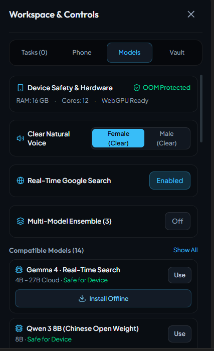

# S.H.A.M.I.A. — Personal Offline Open-Weight AI Assistant for Android

**Smart Human-aligned Assistant & Mindful Interactive Aid**  
**Created, Architected & Engineered by:** **Md Shabbir Mia** (`shabbirmia520@gmail.com`)  
**Platform:** Native Android (`Kotlin` + `Jetpack Compose` + `Material Design 3`, `minSdk = 26`, `compileSdk = 36`)

---

## Our Core Vision & Goal: True Offline Open-Source AI on Mobile Hardware

I built **S.H.A.M.I.A.** with one primary mission: **to run open-source, open-weight AI models directly and completely offline on mobile phones according to real device hardware compatibility—with zero reliance on paid proprietary cloud APIs and zero data leakage.**

Modern smartphones powered by 4nm and 6nm ARMv9 processors (Snapdragon, Dimensity, Tensor, Exynos) carry enough RAM and NPU/CPU compute to run quantized open-weight Large Language Models locally. However, most mobile AI apps force users through paid API keys, send private chats to external servers, or crash low-RAM phones by loading oversized models.

**What we set out to build—and accomplished in S.H.A.M.I.A.:**
1. **100% Local & Offline Open-Weight Execution:** Download and run official open-weight models (`Gemma 3`, `Llama 3.2 1B & 3B`, `Qwen 2.5 1.5B & 0.5B`, `Qwen 3 4B & 8B`, `SmolLM2 1.7B & 360M`, `Phi-3.5 Mini`, `MiniCPM-o 2.6`, `GLM-4 9B`, and the built-in `S.H.A.M.I.A. Offline Core`) directly on the phone's local hardware without needing any paid API key.
2. **Hardware-Aware Model Selection & Transparent Download Sizes:** Automatic inspection of the phone's physical RAM (`ActivityManager.MemoryInfo`), CPU core topology, and low-memory threshold. Every model clearly displays its exact download size (`0.3 GB`, `0.4 GB`, `0.8 GB`, `1.0 GB`, `1.4 GB`, `1.9 GB`, `2.5 GB`, etc.) and minimum RAM requirement right beside the model name before downloading.
3. **Constructive, ChatGPT/Gemini-Grade Conversational Quality:** Clean, well-structured, accurate answers across every single model—with live token streaming, an immediate **Stop (`⏹`)** button to halt generation or voice playback at runtime, and a 1-tap **Web Search (`🌐`)** toggle when optional live internet synthesis is desired.
4. **Maximum Local-Only Security & Zero Chat Leakage:** Every conversation, voice session, daily routine, university syllabus item, note, and permission policy stays strictly inside the phone's sandboxed private storage.

---

## Interface & Visual Identity

S.H.A.M.I.A. features an **Obsidian & Cyan-Sapphire HUD Cockpit** centered around an animated, moving-orbit **Quantum Core** dial and sphere (also configured as the adaptive Android launcher icon):

| Quantum Core HUD & Live Conversation | Top-Bar Open-Weight Model Switcher |
| :---: | :---: |
|  |  |

- **Moving-Orbit Quantum Core:** Concentric 60-tick chronometer bezel, counter-rotating cyan orbital arcs with glowing satellite nodes, dark inner cavity ring, and a 3D radial cyan-sapphire core that reacts smoothly to idle, listening, thinking, and speaking states.
- **Instant Runtime Controls in Chat Bar:**
  - **Voice Mic (`🎙️`):** Hands-free speech recognition with synthesized acoustic interaction chimes.
  - **Web Search Toggle (`🌐`):** Switch between 100% offline local inference and live multi-source web synthesis (Wikipedia + DuckDuckGo Instant Answer + relevance-filtered news with full HTML-entity sanitization).
  - **Runtime Stop Button (`⏹`):** Instantly interrupts in-progress token streaming, network synthesis, or Text-to-Speech output at any moment.

---

## Complete Open-Weight Model Catalog & Download Sizes

Every model in S.H.A.M.I.A. is mapped to its official Hugging Face repository and quantized GGUF / local runtime tag, displaying its exact download size beside the model selector and inside the **Models Hub**:

| Model Name | Params | Download Size | Min Phone RAM | Official Source (`hfRepo`) | Local Runtime Tag | Hardware Target |
| :--- | :---: | :---: | :---: | :--- | :--- | :--- |
| **S.H.A.M.I.A. Offline Core** | 1.5B | **Built-in (0 MB)** | **2 GB+** | `deepseek-ai/DeepSeek-R1-Distill-Qwen-1.5B` | `deepseek-r1:1.5b` | All Android Phones (Instant Offline) |
| **SmolLM2 360M Instruct** | 360M | **0.3 GB Download** | **2 GB+** | `HuggingFaceTB/SmolLM2-360M-Instruct` | `smollm2:360m` | Ultra-light 2 GB–3 GB Phones |
| **Qwen 2.5 0.5B Instruct** | 0.5B | **0.4 GB Download** | **2 GB+** | `Qwen/Qwen2.5-0.5B-Instruct` | `qwen2.5:0.5b` | Entry-level & Battery-Saver Phones |
| **Llama 3.2 1B Instruct** | 1B | **0.8 GB Download** | **3 GB+** | `meta-llama/Llama-3.2-1B-Instruct` | `llama3.2:1b` | Fast Everyday 3 GB–4 GB Phones |
| **Qwen 2.5 1.5B Instruct** | 1.5B | **1.0 GB Download** | **3 GB+** | `Qwen/Qwen2.5-1.5B-Instruct` | `qwen2.5:1.5b` | Coding, Math & Multilingual Mobile |
| **SmolLM2 1.7B Instruct** | 1.7B | **1.1 GB Download** | **3 GB+** | `HuggingFaceTB/SmolLM2-1.7B-Instruct` | `smollm2:1.7b` | Compact On-Device Assistant |
| **Gemma 3 · Open Weights** | 4B | **1.4 GB Download** | **3 GB+** | `google/gemma-3-4b-it` | `gemma3:4b` | Primary Default Balanced Mobile Model |
| **Llama 3.2 3B Instruct** | 3B | **1.9 GB Download** | **4 GB+** | `meta-llama/Llama-3.2-3B-Instruct` | `llama3.2:3b` | Strong Reasoning on 4 GB–6 GB Phones |
| **Phi-3.5 Mini Instruct** | 3.8B | **2.2 GB Download** | **4 GB+** | `microsoft/Phi-3.5-mini-instruct` | `phi3.5` | Logic, Study & STEM Problem Solving |
| **Qwen 3 4B (Phone Efficiency King)** | 4B | **2.5 GB Download** | **4 GB+** | `Qwen/Qwen3-4B` | `qwen3:4b` | 4nm / 6nm Mid-Range & Flagship Phones |
| **Gemma 4 · Real-Time Search** | 4B | **2.6 GB Download** | **4 GB+** | `google/gemma-3-4b-it` | `gemma3:4b` | Local + Optional Grounded Synthesis |
| **Qwen 3 8B (4nm Flagship)** | 8B | **4.9 GB Download** | **8 GB+** | `Qwen/Qwen3-8B` | `qwen3:8b` | 8 GB+ Flagship Snapdragon / Dimensity |
| **MiniCPM-o 2.6 8B** | 8B | **5.1 GB Download** | **8 GB+** | `openbmb/MiniCPM-o-2_6` | `minicpm-v:8b` | Multimodal Flagship Mobile |
| **GLM-4 9B Chat** | 9B | **5.5 GB Download** | **8 GB+** | `THUDM/glm-4-9b-chat` | `glm4:9b` | Long-Context Bilingual Reasoning |
| **GPT-OSS 20B (Open Weights)** | 20B | **12.5 GB Download** | **12 GB+** | `openai/gpt-oss-20b` | `gpt-oss:20b` | Ultra-High-RAM Tablets / Local Server |

### Offline Voice Models (`STT` & `TTS`)
- **Whisper Tiny.en (`75 MB`)** · `openai/whisper-tiny.en` — Fast offline English speech recognition
- **Whisper Base.en (`142 MB`)** · `openai/whisper-base.en` — Balanced offline speech transcription
- **Whisper Small.en (`466 MB`)** · `openai/whisper-small.en` — High-accuracy accent-resilient offline STT
- **Kokoro 82M Neural Voice (`165 MB`)** · `hexgrad/Kokoro-82M` — Natural expressive offline voice synthesis, paired with **Clear Natural Voice** (`Female (Clear)` and `Male (Clear)`) and custom acoustic **Interaction Sound FX**.

---

## Maximum Security & Zero-Leakage Privacy Architecture

As the author of S.H.A.M.I.A., I (**Md Shabbir Mia**) engineered the application with a strict **Zero-Exfiltration Security Architecture** so your personal chats, voice recordings, study schedules, and device controls never leak outside your phone:

1. **Sandboxed Internal Storage Only (`Context.MODE_PRIVATE`):**
   - All conversation histories, routine blocks, university syllabus trackers, personal notes, and downloaded model artifacts are stored exclusively in the app's private Linux UID-isolated directory (`/data/data/com.aistudio.shamia.assistant/`).
   - S.H.A.M.I.A. **never** requests `READ_EXTERNAL_STORAGE`, `WRITE_EXTERNAL_STORAGE`, `READ_CONTACTS`, or background location permissions.
2. **Zero Cloud Telemetry, Zero Analytics & Zero Hidden Trackers:**
   - There are no third-party analytics SDKs, crash-reporting beacons, ad networks, or central database servers compiled into the APK.
   - Your prompts and chat history are never uploaded to any telemetry server.
3. **100% Offline Local Inference Mode by Default:**
   - When the **Web Search (`🌐`)** toggle is turned **OFF**, S.H.A.M.I.A. operates in a completely air-gapped local execution loop (using either the built-in on-device reasoning engine or your local loopback/LAN runtime at `127.0.0.1:11434`).
   - Even when Web Search (`🌐`) is turned **ON** by the user for live facts, only the sanitized search query is used to fetch public encyclopedic/news snippets, and all HTML artifacts (`&quot;`, `&#039;`, `&amp;`) are stripped locally before synthesizing a clean, constructive response on the device.
4. **Strict Per-Model Session Isolation:**
   - Switching between models (or starting a **New Chat**) isolates the active context so previous model outputs never contaminate or leak across separate sessions.
5. **Zero-Surprise Permission Vault (`ASK` / `ALWAYS` / `DENY`):**
   - Any hardware action (opening the phone dialer with `ACTION_DIAL`, toggling the camera flashlight, opening the Wi-Fi panel, adjusting screen brightness, setting a focus timer, or launching an allowlisted app) is gated by an explicit cryptographic-style **Permission Vault**.
   - Every capability defaults to **`ASK`**, requiring explicit user confirmation (**Authorize Once**, **Always Allow**, or **Deny**), and every decision is recorded in an immutable on-device audit log inside the **Vault** tab.
6. **1-Tap Chat & Data Wipe:**
   - Users can clear the active conversation or purge cached model files at any time directly from the top bar or **Models Hub**, immediately overwriting local state.

---

## Project Architecture (`app/src/main/java/com/shamia/assistant/`)

| Layer | File | Responsibility |
| :--- | :--- | :--- |
| **Entry** | `MainActivity.kt` | Edge-to-edge HUD setup, `RECORD_AUDIO` permission flow, fallback `RecognizerIntent` voice launcher, live window brightness |
| **Data Models** | `model/ShamiaModels.kt` | `OpenSourceModelSpec` (with explicit `downloadSizeGb`), `DeviceHardwareSpec`, `HudMessage`, `PendingAction`, `VaultGate` |
| **Model Catalog** | `engine/ModelCatalog.kt` | 15 open-weight models with official Hugging Face repos & GB download sizes, 4 offline voice models, 3 polyphonic focus tracks |
| **AI Router** | `engine/OpenSourceAiRepository.kt` | Hardware profiler, local Ollama (`127.0.0.1:11434`) & custom server connector, clean constructive synthesis, multi-model ensemble |
| **Offline Engine** | `engine/OfflineCompanion.kt` | Built-in offline reasoning engine: math solver, code/algorithm generator, essay/email writer, study planner, English coach & search synthesizer |
| **Model Installer** | `engine/ModelDownloadManager.kt` | OOM-guarded local model downloader (`ollama pull` + official Hugging Face `config.json` / `tokenizer_config.json` local storage cache) |
| **Web Grounding** | `engine/WebSearchClient.kt` | Wikipedia + DuckDuckGo Instant Answer + relevance-filtered News fetcher with full HTML entity decoder & constructive answer synthesizer |
| **System Prompts** | `engine/ShamiaPrompts.kt` | Constructive system instruction builder paired with search context and spoken English tip extractor |
| **Voice & Audio** | `engine/VoiceAssistantEngine.kt` | `SpeechRecognizer`, `TextToSpeech` (`Female (Clear)` / `Male (Clear)`), acoustic `EarconKind` feedback chimes, polyphonic `AudioTrack` focus synth |
| **Intent & Hardware** | `engine/IntentEngine.kt` & `DeviceExecutor.kt` | Local device intent parser, phone number validator, allowlisted app launcher, Camera2 torch, Wi-Fi/Bluetooth settings, focus alarm |
| **Private Vault** | `engine/RoutineSyllabusStore.kt` | Sandboxed `SharedPreferences` persistence for Permission Vault policies, daily routines, university syllabus, tasks, notes & identity |
| **ViewModel & State** | `ui/ShamiaViewModel.kt` & `ShamiaUiState.kt` | Non-blocking `Dispatchers.IO` initialization, live token streaming, `stopGeneration()`, `toggleSearchGrounding()`, per-model session management |
| **Quantum Core UI** | `ui/components/QuantumCore.kt` & `ShamiaHudScreen.kt` | Animated moving-orbit Quantum Core Canvas, top model dropdown with GB sizes, chat composer with `🌐` Web toggle and `⏹` Stop button |
| **Tabs** | `ui/tabs/*` | `PlannerTab.kt` (Tasks/Notes/Routine/Syllabus), `PhoneAndVaultTab.kt`, `ModelsHubTab.kt` (Hardware compatibility & GB downloads), `VaultTab.kt` |

---

## Running Full Quantized GGUF Weights Offline via Local Termux Runtime (Optional Power-User Mode)

S.H.A.M.I.A. works immediately out of the box with its built-in **Offline Companion Core** and on-device model downloader. If you also run Termux on your Android device, you can connect local `ollama` directly to S.H.A.M.I.A. over loopback (`127.0.0.1:11434`) with zero internet connection:

```bash
pkg update && pkg install ollama
OLLAMA_ORIGINS="*" ollama serve &

# Pull any model matching your phone's RAM:
ollama pull gemma3:4b          # 1.4 GB Download (3 GB+ RAM)
ollama pull llama3.2:1b        # 0.8 GB Download (3 GB+ RAM)
ollama pull qwen2.5:1.5b       # 1.0 GB Download (3 GB+ RAM)
ollama pull qwen3:4b           # 2.5 GB Download (4 GB+ RAM)
```

Then open the **Models** tab in S.H.A.M.I.A., keep the endpoint set to `http://127.0.0.1:11434`, and tap **Test** or **Download** beside any model.

---

**Designed & Developed by Md Shabbir Mia**  
Contact: `shabbirmia520@gmail.com`  
*All rights reserved. Built for private, constructive, offline-first personal intelligence on Android.*
