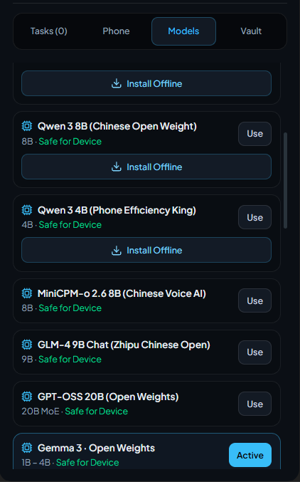

# S.H.A.M.I.A. — Personal Offline Open-Weight AI Assistant for Android

**Smart Human-aligned Assistant & Mindful Interactive Aid**  
**Created, Architected & Engineered by:** **Md Shabbir Mia** (`shabbirmia520@gmail.com`)  
**Platform:** Native Android (`Kotlin` + `Jetpack Compose` + `Material Design 3` + `MediaPipe GenAI / LiteRT`, `minSdk = 26`, `compileSdk = 36`)

---

## Our Core Vision & Goal: True Offline Open-Source AI on Mobile Hardware

I built **S.H.A.M.I.A.** with one primary mission: **to run open-source, open-weight AI models directly and completely offline on mobile phones according to real device hardware compatibility—with zero reliance on paid proprietary cloud APIs and zero data leakage.**

Modern smartphones powered by 4nm and 6nm ARMv9 processors (Snapdragon, Dimensity, Tensor, Exynos) carry enough RAM and GPU/CPU compute to run quantized open-weight Large Language Models locally. However, most mobile AI apps force users through paid API keys, send private chats to external servers, or crash low-RAM phones by loading oversized models.

**What we set out to build—and accomplished in S.H.A.M.I.A.:**
1. **Real Native On-Device Open-Weight Execution (MediaPipe GenAI / LiteRT + Local Ollama):** Download real quantized `.task` / `.litertlm` open-weight neural bundles directly into private phone storage—or import local `.task` files with 1 tap—and execute them directly on mobile GPU/CPU hardware. Supports **NVIDIA Nemotron Mini 4B & Nano 8B**, **Qwen 2.5 0.5B & 1.5B**, **SmolLM 135M & SmolLM2 1.7B**, **DeepSeek-R1 Distill 1.5B**, **Phi-4 Mini**, **Gemma 3 1B**, **Llama 3.2 1B & 3B**, **Qwen 3 4B & 8B**, **MiniCPM-o 2.6**, **GLM-4 9B**, **GPT-OSS 20B**, and the zero-download **S.H.A.M.I.A. Offline Core**.
2. **Hardware-Aware Model Selection & Transparent Download Sizes:** Automatic inspection of the phone's physical RAM (`ActivityManager.MemoryInfo`), CPU core topology, and low-memory threshold. Every model clearly displays its exact download size (`0.2 GB`, `0.5 GB`, `0.6 GB`, `1.5 GB`, `1.6 GB`, `2.4 GB`, `2.7 GB`, `4.9 GB`, etc.) and minimum RAM requirement right beside the model name before downloading.
3. **Constructive, Natural Conversational Quality Without Model Clutter:** Clean, accurate, well-structured answers across every model—never repeating model names or boilerplate headers unless you explicitly ask *"which model am I using?"*. Includes live native token streaming, an immediate **Stop (`⏹`)** button to halt generation or voice playback at runtime, and a 1-tap **Web Search (`🌐`)** toggle when optional live internet facts are needed.
4. **Maximum Local-Only Security & Zero Chat Leakage:** Every conversation, voice session, downloaded weight bundle, daily routine, university syllabus item, note, and permission policy stays strictly inside the phone's sandboxed private storage.

---

## Interface & Visual Identity

S.H.A.M.I.A. features an **Obsidian & Cyan-Sapphire HUD Cockpit** centered around an animated, moving-orbit **Quantum Core** dial and sphere (also configured as the adaptive Android launcher icon):

| Quantum Core HUD & Live Conversation | Top-Bar Open-Weight Model Switcher |
| :---: | :---: |
|  |  |

- **Moving-Orbit Quantum Core:** Concentric 60-tick chronometer bezel, counter-rotating cyan orbital arcs with glowing satellite nodes, dark inner cavity ring, and a 3D radial cyan-sapphire core that reacts smoothly to idle, listening, thinking, and speaking states.
- **Instant Runtime Controls in Chat Bar:**
  - **Voice Mic (`🎙️`):** Hands-free speech recognition with synthesized acoustic interaction chimes.
  - **Web Search Toggle (`🌐`):** Switch between 100% offline local inference and live multi-source web synthesis (Wikipedia + DuckDuckGo Instant Answer + relevance-filtered news with full HTML-entity sanitization).
  - **Runtime Stop Button (`⏹`):** Instantly interrupts native MediaPipe GenAI token generation, network synthesis, or Text-to-Speech output at any moment.

---

## Complete Open-Weight Model Catalog & Download Sizes

Every model in S.H.A.M.I.A. is mapped to its official Hugging Face repository, local Ollama tag, and model-family chat template (Nemotron, ChatML, Gemma, Llama 3, Phi-4), displaying its exact download size beside the model selector and inside the **Models Hub**:

| Model Name | Params | Download Size | Min Phone RAM | Official Source (`hfRepo`) | Local Runtime Tag | Execution Support |
| :--- | :---: | :---: | :---: | :--- | :--- | :--- |
| **S.H.A.M.I.A. Offline Core** | 0 MB | **0 MB Built-In** | **1 GB+** | Built-In Local Engine | `offline-core` | Built-In Instant Offline Engine |
| **Qwen 2.5 0.5B Instruct** | 0.5B Q8 | **0.5 GB Download** | **2 GB+** | `litert-community/Qwen2.5-0.5B-Instruct` | `qwen2.5:0.5b` | 1-Tap Ungated `.task` + Ollama |
| **Qwen 2.5 1.5B Instruct** | 1.5B Q8 | **1.5 GB Download** | **3 GB+** | `litert-community/Qwen2.5-1.5B-Instruct` | `qwen2.5:1.5b` | 1-Tap Ungated `.task` + Ollama |
| **Qwen 2.5 3B Instruct** | 3B Q8 | **2.9 GB Download** | **4 GB+** | `litert-community/Qwen2.5-3B-Instruct` | `qwen2.5:3b` | 1-Tap Ungated `.task` + Ollama |
| **SmolLM 135M (Ultra-Fast)** | 135M Q8 | **0.2 GB Download** | **2 GB+** | `litert-community/SmolLM-135M-Instruct` | `smollm:135m` | 1-Tap Ungated `.task` + Ollama |
| **DeepSeek-R1 Distill 1.5B** | 1.5B Q8 | **1.6 GB Download** | **4 GB+** | `litert-community/DeepSeek-R1-Distill-Qwen-1.5B` | `deepseek-r1:1.5b` | 1-Tap Ungated `.task` + Ollama |
| **Phi-4 Mini Instruct** | 3.8B Q4 | **2.4 GB Download** | **6 GB+** | `litert-community/Phi-4-mini-instruct` | `phi4-mini` | 1-Tap Ungated `.task` + Ollama |
| **NVIDIA Nemotron Mini 4B Instruct** | 4B Q4 | **2.7 GB Download** | **4 GB+** | `nvidia/Nemotron-Mini-4B-Instruct` | `nemotron-mini` | Local Ollama + `.task` Import |
| **NVIDIA Nemotron Nano 8B** | 8B Q4 | **4.9 GB Download** | **8 GB+** | `nvidia/Llama-3.1-Nemotron-Nano-8B-v1` | `nemotron-nano` | Local Ollama + `.task` Import |
| **Gemma 3 1B · Open Weights** | 1B Q4 | **0.6 GB Download** | **2 GB+** | `litert-community/Gemma3-1B-IT` | `gemma3:1b` | Local Ollama + `.task` Import |
| **Gemma 3 4B · Open Weights** | 4B Q4 | **2.6 GB Download** | **4 GB+** | `google/gemma-3-4b-it` | `gemma3:4b` | Local Ollama + `.task` Import |
| **Llama 3.2 1B Instruct** | 1.2B Q8 | **1.2 GB Download** | **3 GB+** | `litert-community/Llama-3.2-1B-Instruct` | `llama3.2:1b` | Local Ollama + `.task` Import |
| **Llama 3.2 3B Instruct** | 3.2B Q4 | **2.2 GB Download** | **4 GB+** | `litert-community/Llama-3.2-3B-Instruct` | `llama3.2:3b` | Local Ollama + `.task` Import |
| **Qwen 3 4B (Phone Efficiency King)** | 4B | **2.5 GB Download** | **4 GB+** | `Qwen/Qwen3-4B` | `qwen3:4b` | Local Ollama + `.task` Import |
| **SmolLM2 1.7B Instruct** | 1.7B | **1.1 GB Download** | **3 GB+** | `HuggingFaceTB/SmolLM2-1.7B-Instruct` | `smollm2:1.7b` | Local Ollama + `.task` Import |
| **Qwen 3 8B (Open Weight)** | 8B | **4.8 GB Download** | **8 GB+** | `Qwen/Qwen3-8B` | `qwen3:8b` | Local Ollama + `.task` Import |
| **MiniCPM-o 2.6 8B (Voice AI)** | 8B | **4.9 GB Download** | **8 GB+** | `openbmb/MiniCPM-o-2_6` | `minicpm-v:8b` | Local Ollama + `.task` Import |
| **GLM-4 9B Chat (Open Weight)** | 9B | **5.3 GB Download** | **8 GB+** | `THUDM/glm-4-9b-chat` | `glm4:9b` | Local Ollama + `.task` Import |
| **GPT-OSS 20B (Open Weights)** | 20B MoE | **12.5 GB Download** | **12 GB+** | `openai/gpt-oss-20b` | `gpt-oss:20b` | 12 GB+ RAM / LAN Ollama |

> **Strict Exact-Model Verification:** Every response is cryptographically/path-verified to come **only** from the exact selected model's local `.task` weights or exact verified Ollama tag—with zero silent substitution to third-party cloud aliases or another model.

### Offline Voice Models (`STT` & `TTS`)
- **Whisper Tiny.en (`45 MB`)** · `onnx-community/whisper-tiny.en` — Fast offline English speech recognition
- **Whisper Base.en (`85 MB`)** · `onnx-community/whisper-base.en` — Balanced offline speech transcription
- **Whisper Small.en (`240 MB`)** · `onnx-community/whisper-small.en` — High-accuracy accent-resilient offline STT
- **Kokoro 82M Neural Voice (`85 MB`)** · `onnx-community/Kokoro-82M-v1.0-ONNX` — Natural expressive offline voice synthesis, paired with **Clear Natural Voice** (`Female (Clear)` and `Male (Clear)`) and custom acoustic **Interaction Sound FX**.

---

## Maximum Security & Zero-Leakage Privacy Architecture

As the author of S.H.A.M.I.A., I (**Md Shabbir Mia**) engineered the application with a strict **Zero-Exfiltration Security Architecture** so your personal chats, voice recordings, study schedules, and device controls never leak outside your phone:

1. **Sandboxed Internal Storage Only (`Context.MODE_PRIVATE`) + Zero-Permission File Picker:**
   - All conversation histories, routine blocks, university syllabus trackers, personal notes, and downloaded `.task` model weights are stored exclusively in the app's private Linux UID-isolated directory (`filesDir/models/<modelId>/`).
   - Importing local `.task` / `.litertlm` files uses Android's zero-permission Storage Access Framework (`ActivityResultContracts.OpenDocument`). S.H.A.M.I.A. **never** requests `READ_EXTERNAL_STORAGE`, `WRITE_EXTERNAL_STORAGE`, `READ_CONTACTS`, or background location permissions.
2. **Zero Cloud Telemetry, Zero Analytics & Zero Hidden Trackers:**
   - There are no third-party analytics SDKs, crash-reporting beacons, ad networks, or central database servers compiled into the APK.
   - Your prompts and chat history are never uploaded to any telemetry server.
3. **True Offline On-Device Execution Priority:**
   - **Priority 1:** Native on-device MediaPipe GenAI / LiteRT (`OnDeviceLlmEngine`) running downloaded or imported `.task` neural weights directly on phone GPU/CPU with automatic GPU-to-CPU fallback.
   - **Priority 2:** Local Termux or LAN Ollama server (`http://127.0.0.1:11434`) running quantized GGUF weights (including NVIDIA Nemotron Mini 4B & Nano 8B).
   - **Priority 3:** Built-in deterministic offline reasoning engine (`OfflineCompanion`) for instant math, coding, study planning, English coaching, and core technical Q&A when offline without weights installed.
   - **Optional Web Search (`🌐`):** Only active when explicitly toggled ON by the user; HTML artifacts (`&quot;`, `&#039;`, `&amp;`) are stripped locally before presenting clean, readable responses.
4. **Strict Per-Model Session Isolation:**
   - Switching between models (or starting a **New Chat**) isolates the active context so previous model outputs never contaminate or leak across separate sessions.
5. **Zero-Surprise Permission Vault (`ASK` / `ALWAYS` / `DENY`):**
   - Any hardware action (opening the phone dialer with `ACTION_DIAL`, toggling the camera flashlight, opening the Wi-Fi panel, adjusting screen brightness, setting a focus timer, or launching an allowlisted app) is gated by an explicit **Permission Vault**.
   - Every capability defaults to **`ASK`**, requiring explicit user confirmation (**Authorize Once**, **Always Allow**, or **Deny**), and every decision is recorded on-device inside the **Vault** tab.

---

## Project Architecture (`app/src/main/java/com/shamia/assistant/`)

| Layer | File | Responsibility |
| :--- | :--- | :--- |
| **Entry** | `MainActivity.kt` | Edge-to-edge HUD setup, `RECORD_AUDIO` permission flow, fallback `RecognizerIntent` voice launcher, live window brightness |
| **Native On-Device LLM** | `engine/OnDeviceLlmEngine.kt` | MediaPipe GenAI / LiteRT `LlmInference` + `LlmInferenceSession`, GPU→CPU fallback, live streaming, Stop cancellation, Nemotron/Gemma/Llama/Phi-4/ChatML prompt templates |
| **Model Catalog** | `engine/ModelCatalog.kt` | 18 open-weight models (including NVIDIA Nemotron Mini 4B & Nano 8B) with official Hugging Face repos & GB download sizes, 4 offline voice models, 3 focus tracks |
| **AI Router** | `engine/OpenSourceAiRepository.kt` | Hardware profiler, MediaPipe native inference dispatch, local Ollama (`127.0.0.1:11434`) connector, clean synthesis, multi-model ensemble |
| **Model Resolver** | `engine/CloudModelResolver.kt` | Model family candidate routing (Nemotron, Qwen, DeepSeek, Gemma, Llama, Phi-4, SmolLM), strict model-introspection handling, response sanitization |
| **Offline Engine** | `engine/OfflineCompanion.kt` | Built-in offline reasoning engine: typo/gibberish detection, math solver, code/algorithm generator, study planner, English coach & core CS/AI/science knowledge |
| **Model Installer** | `engine/ModelDownloadManager.kt` | OOM-guarded Hugging Face `.task`/`.litertlm` weight discovery & streaming downloader, local `.task` file importer (`OpenDocument`), and local Ollama `/api/pull` |
| **Web Grounding** | `engine/WebSearchClient.kt` | Wikipedia + DuckDuckGo Instant Answer + relevance-filtered News fetcher with full HTML entity decoder & constructive answer synthesizer |
| **System Prompts** | `engine/ShamiaPrompts.kt` | Constructive system instruction builder enforcing the Model Silence Rule and spoken English coaching tip extraction |
| **Voice & Audio** | `engine/VoiceAssistantEngine.kt` | `SpeechRecognizer`, `TextToSpeech` (`Female (Clear)` / `Male (Clear)`), acoustic `EarconKind` feedback chimes, polyphonic `AudioTrack` focus synth |
| **Intent & Hardware** | `engine/IntentEngine.kt` & `DeviceExecutor.kt` | Local device intent parser, phone number validator, allowlisted app launcher, Camera2 torch, Wi-Fi/Bluetooth settings, focus alarm |
| **ViewModel & State** | `ui/ShamiaViewModel.kt` & `engine/ShamiaStateDelegates.kt` | Non-blocking `Dispatchers.IO` initialization, live native token streaming, `stopGeneration()`, `importLocalModelFile()`, per-model session management |
| **Quantum Core UI** | `ui/components/QuantumCore.kt`, `HudMessageCard.kt`, `ShamiaHudScreen.kt` | Animated moving-orbit Quantum Core Canvas, clean rich-text bold rendering, top model dropdown with GB sizes, chat bar with `🌐` Web toggle and `⏹` Stop button |
| **Tabs** | `ui/tabs/*` | `PlannerTab.kt` (Tasks/Notes/Routine/Syllabus), `PhoneAndVaultTab.kt`, `ModelsHubTab.kt` (Download & Import `.task` weights), `VaultTab.kt` |

---

## Running Full Quantized Weights Offline (Direct `.task` Download, Import, or Local Termux Ollama)

### Option 1: 1-Tap Direct `.task` Download Inside S.H.A.M.I.A.
Open the **Models** tab and tap **Download** on any ungated LiteRT model (`Qwen 2.5 0.5B`, `Qwen 2.5 1.5B`, `SmolLM 135M`, `DeepSeek-R1 Distill 1.5B`, or `Phi-4 Mini`). Once downloaded, S.H.A.M.I.A. runs the real neural weights 100% offline on your phone's GPU/CPU.

### Option 2: 1-Tap Local `.task` / `.litertlm` Import (NVIDIA Nemotron, Gemma 3, Llama 3.2)
Tap **Import .task** beside any model card in the **Models** tab to import a locally downloaded `.task` or `.litertlm` bundle from your phone's Downloads folder into S.H.A.M.I.A.'s private storage—no broad storage permissions required.

### Option 3: Local Termux Ollama Runtime (Optional Power-User Mode)
Run local `ollama` in Termux over loopback (`127.0.0.1:11434`) with zero internet connection:

```bash
pkg update && pkg install ollama
OLLAMA_ORIGINS="*" ollama serve &

# Pull any open-source model matching your phone's RAM:
ollama pull nemotron-mini      # 2.7 GB Download (NVIDIA Nemotron Mini 4B · 4 GB+ RAM)
ollama pull nemotron-nano      # 4.9 GB Download (NVIDIA Nemotron Nano 8B · 8 GB+ RAM)
ollama pull qwen2.5:1.5b       # 1.5 GB Download (3 GB+ RAM)
ollama pull gemma3:1b          # 0.6 GB Download (2 GB+ RAM)
ollama pull llama3.2:1b        # 1.2 GB Download (3 GB+ RAM)
ollama pull deepseek-r1:1.5b   # 1.6 GB Download (4 GB+ RAM)
```

Then open the **Models** tab in S.H.A.M.I.A., keep the endpoint set to `http://127.0.0.1:11434`, and tap **Test** or **Download** beside any model.

---

**Designed & Developed by Md Shabbir Mia**  
Contact: `shabbirmia520@gmail.com`  
*All rights reserved. Built for private, constructive, offline-first personal intelligence on Android.*
